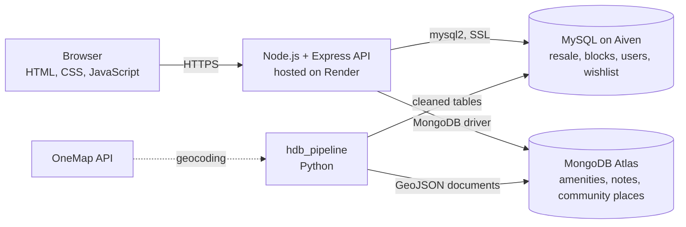

# Haven. Smart HDB Resale & Accessibility Planner

Haven helps Singapore home buyers compare HDB resale flats not just by price, but by how easy daily life is around them. It combines almost one million resale transactions with the locations of MRT exits, bus stops, hawker centres, parks and childcare centres, and gives every block a personal accessibility score.

**Live site:** https://haven-hdb.onrender.com
(hosted on Render's free tier, so the first visit after a quiet period can take a moment to wake up)

INF2003 Database Systems group project, Singapore Institute of Technology.

---

## Contents

1. [Features](#features)
2. [Architecture](#architecture)
3. [Repository layout](#repository-layout)
4. [Datasets](#datasets)
5. [Database design](#database-design)
6. [Run it locally](#run-it-locally)
7. [Rebuild the databases from the raw data](#rebuild-the-databases-from-the-raw-data)
8. [User manual](#user-manual)
9. [API reference](#api-reference)
10. [Performance and verification scripts](#performance-and-verification-scripts)
11. [Security](#security)
12. [Known limitations](#known-limitations)

---

## Features

- **Search resale sales** by keyword, town, flat type and price range, sorted by date or price.
- **Block page** with block details, price statistics, the latest sales, an amenity map, and a personal accessibility score set by weighted sliders.
- **Compare** two blocks side by side.
- **Market insights:** counts, averages, minimums and maximums by year, flat type and town.
- **Neighbourhoods:** town pages with MRT, bus stops, hawker centres, parks and childcare in each town.
- **Wishlist** (MySQL CRUD): save blocks with a priority and notes.
- **Community notes and places** (MongoDB CRUD): rate blocks and add places the official data misses.
- **Accounts:** sign up with email and password, or sign in with Google.

## Architecture



**Why two databases?** Resale data has a fixed structure and clear relationships, so it lives in a normalised MySQL schema with foreign keys, constraints and transactions. Amenity data is geographic (points and park polygons) with fields that vary by dataset, so it lives in MongoDB as GeoJSON documents with `2dsphere` indexes.

**Example request.** Opening a block page calls `GET /api/blocks/:id/amenities`. The API reads the block's coordinates from MySQL, runs five `$geoNear` searches in MongoDB (one per amenity type) at the same time, merges the results into one response, and caches it in memory for 5 minutes.

## Repository layout

```
├── backend/                  Node.js + Express API (serves the frontend too)
│   ├── server.js             app setup, search and block endpoints
│   ├── routes/               auth, wishlist, notes, community, towns, insights, amenities
│   ├── db.js  mongo.js       MySQL pool and MongoDB connection
│   ├── session.js            sessions stored in MySQL
│   ├── googleAuth.js         Google OAuth 2.0 (Passport)
│   ├── amenities-cache.js    5-minute in-memory cache
│   ├── benchmark-*.js        performance benchmarks
│   ├── check-*.js            schema, index and query-plan checks
│   └── .env.example          settings template
├── frontend/                 static pages (index, explore, block, compare, insights,
│                             neighbourhoods, town, wishlist, login)
├── database/schema.sql       MySQL schema (structure only)
├── hdb_pipeline/             Python data cleaning and geocoding pipeline
├── clean_data_walkthrough.ipynb   step-by-step view of the cleaning
├── geocode/                  saved OneMap results, so geocoding need not be repeated
├── import_mysql.py           bulk loader for resale_transaction
└── MongoDB/                  MongoDB loader and checks (see MongoDB/README.md)
```

## Datasets

All from [data.gov.sg](https://data.gov.sg).

| Dataset | Publisher | Records | Stored in |
|---|---|---|---|
| Resale Flat Prices (5 files, 1990 to present) | HDB | 987,234 sales | MySQL |
| HDB Property Information | HDB | 13,357 blocks | MySQL |
| Hawker Centres | NEA | 129 centres | MongoDB |
| Bus Stops | LTA | 5,205 stops | MongoDB |
| MRT/LRT Station Exits | LTA | 613 exits | MongoDB |
| Parks and Nature Reserves | NParks | 462 areas (polygons) | MongoDB |
| Listing of Centres (childcare) | ECDA | 1,870 centres | MongoDB |

Raw files are not stored in this repository. Download them from data.gov.sg and put them in one folder (see [step 1](#1-clean-and-geocode-the-data)).

## Database design

### MySQL (relational)

Six tables in third normal form hold the property data, plus four tables for accounts. The full definition is in [`database/schema.sql`](database/schema.sql).

| Table | Primary key | Foreign keys and constraints |
|---|---|---|
| `town` | `town_id` | UNIQUE (`town_name`) |
| `flat_type` | `flat_type_id` | UNIQUE (`flat_type_name`) |
| `flat_model` | `flat_model_id` | UNIQUE (`model_name`) |
| `block` | `block_id` | `town_id` → town |
| `block_unit_count` | (`block_id`, `flat_type_id`, `tenure`) | `block_id` → block; `flat_type_id` → flat_type |
| `resale_transaction` | `transaction_id` | `block_id` → block; `flat_type_id` → flat_type; `flat_model_id` → flat_model; CHECK (`resale_price` > 0) |
| `users` | `user_id` | UNIQUE (`email`) |
| `user_auth_methods` | `auth_id` | `user_id` → users; UNIQUE (`provider`, `provider_user_id`); provider is `local` or `google` |
| `user_wishlist` | `wishlist_id` | `user_id` → users; `block_id` → block; UNIQUE (`user_id`, `block_id`) |
| `sessions` | `session_id` | created by express-mysql-session |

- **Relationships:** Town → Block and Block → Resale transaction are 1 : M. Resale transaction → Flat type and → Flat model are M : 1. Block ↔ Flat type is M : N, resolved by the junction table `block_unit_count`.
- **Surrogate key:** `block` uses `block_id` because postal codes had 556 blanks and 3 duplicates.
- **Indexes:** every foreign key, plus `sale_date` and `resale_price` on `resale_transaction`.

### MongoDB (document)

Database `hdb`. Every collection stores its position as a GeoJSON `location` Point with a `2dsphere` index.

| Collection | Contents | Loaded by |
|---|---|---|
| `hawker_centres`, `bus_stops`, `mrt_exits` | amenity points | `MongoDB/load_mongo.py` |
| `parks` | centre point plus `geometry` polygon | `MongoDB/load_mongo.py` |
| `childcare_centres` | nested programmes and vacancy by age group | `MongoDB/load_mongo.py` |
| `blocks` | read-only copy of MySQL blocks with coordinates | `MongoDB/load_mongo.py` |
| `block_notes` | user notes with optional 1 to 5 rating and tags | created by the app, with a `$jsonSchema` validator |
| `community_places` | places added by users | created by the app, with a `$jsonSchema` validator |

## Run it locally

**You need:** Node.js 20 or newer, plus access to the team's Aiven MySQL and MongoDB Atlas (or your own copies, built as described in the next section).

```bash
cd backend
npm install
cp .env.example .env        # Windows: copy .env.example .env
```

Fill in `backend/.env`:

| Setting | What to put |
|---|---|
| `DB_HOST`, `DB_PORT`, `DB_USER`, `DB_PASSWORD`, `DB_NAME` | from the Aiven console |
| `DB_SSL_CA` | name of the Aiven CA file saved in `backend/` (e.g. `ca.pem`). On Render, paste the certificate text instead |
| `MONGO_URI` | MongoDB Atlas connection string |
| `SESSION_SECRET` | any random string of at least 32 characters |
| `GOOGLE_CLIENT_ID`, `GOOGLE_CLIENT_SECRET`, `GOOGLE_CALLBACK_URL` | from Google Cloud Console; only needed for Google sign-in |

Then start the server **from the `backend` folder**:

```bash
npm start
```

Open http://localhost:3000. To check the connections, visit `/api/health` (MySQL) and `/api/mongodb/health` (MongoDB), or run `npm run test-db`.

## Rebuild the databases from the raw data

Only needed if you are setting up new databases. The team's live databases are already loaded.

### 1. Clean and geocode the data

Needs Python 3.10+ and `pandas` (`pip install pandas`). Run from the repository root:

```bash
python -m hdb_pipeline.run --raw "C:\path\to\raw files" --out pipeline_output
```

The raw folder can contain `ResaleFlatPrices.zip` as downloaded; it is unzipped automatically. The raw folder is only read, never changed.

| Stage | Writes |
|---|---|
| `clean` | `cleaned/`: one CSV per dataset, plus `.geojson` for MongoDB |
| `geocode_streets` | approximate point per street (about 670 OneMap lookups, minutes) |
| `geocode` | exact point and postal code per block (about 13,500 lookups, hours; speed adapts to OneMap's limit; stop with Ctrl+C and resume later) |
| `geocode_childcare` | coordinates per childcare centre (reuses block results first) |
| `tables` | `tables/`: one CSV per relational table |
| `validate` | `reports/validation_report.csv`: PASS, WARN or FAIL per check |
| `relationships` | `reports/relationship_report.csv`: proves each 1 : M, M : 1 and M : N link from the data |

To rerun only some stages: `--stages tables,validate`. Geocoding needs internet; copy the files in `geocode/` into `pipeline_output/` first to skip lookups that are already done. To see the cleaning step by step, open `clean_data_walkthrough.ipynb`, set `RAW` in the first cell, and run the cells in order.

Cleaning rules: duplicates are flagged, not deleted; remaining lease before 2015 is estimated and flagged (`lease_is_estimated`); no missing value is invented.

### 2. Load MySQL

1. Create the tables: run `database/schema.sql` on your MySQL database (e.g. open it in MySQL Workbench and execute).
2. Load the small tables from `pipeline_output/tables/`, parents first: `town` → `flat_type` → `flat_model` → `block` → `block_unit_count` (e.g. with MySQL Workbench's Table Data Import Wizard).
3. Load the 987,234 resale rows: edit the connection settings and `CA_CERT` path at the top of `import_mysql.py`, then run `pip install mysql-connector-python` and `python import_mysql.py`. It loads in batches of 1,000 and checks the final row count.

### 3. Load MongoDB

See [`MongoDB/README.md`](MongoDB/README.md). In short:

```bash
pip install -r MongoDB/requirements.txt
cp MongoDB/.env.example MongoDB/.env    # then add MONGO_URI
python MongoDB/test_mongo.py            # connection test
python MongoDB/load_mongo.py            # builds the six collections from pipeline_output
python MongoDB/check_mongo.py           # compares MongoDB with the cleaned files
python MongoDB/verify_mongo.py          # runs sample geospatial queries
```

`block_notes` and `community_places` are created automatically the first time the backend starts.

## User manual

| Page | How to use it |
|---|---|
| **Home** | Start a search, or jump to Explore, Neighbourhoods or Insights from the menu. |
| **Explore** | Type a block, street or town, and pick a town, flat type and price range if you want. Sort by newest, oldest, cheapest or most expensive. Results come 12 per page. Click a result to open its block. |
| **Block** | Shows block details, price statistics and the latest 20 sales. The map shows MRT exits, bus stops, hawker centres, parks and childcare centres within the chosen radius (100 to 5,000 m). Move the sliders to set what matters to you; the accessibility score updates straight away. Tick "include community places" to add user-submitted places. Logged-in users can save the block to their wishlist and write a note. |
| **Compare** | Search for two blocks to see their prices and amenities side by side. |
| **Insights** | Market overview, yearly trends, prices by flat type, and towns ranked by average price. Filter by town, flat type and years. |
| **Neighbourhoods / Town** | Search for a town to see its statistics and its MRT exits, bus stops, hawker centres, parks and childcare centres. |
| **Wishlist** | Logged-in users see their saved blocks ranked by priority (High, Medium, Low), change the priority or notes, or remove a block. |
| **Login** | Sign up with a username, email and password, or sign in with Google. |

**Accessibility score.** For each amenity type, the nearest place scores 100 × (1 − distance ÷ radius), so something next door scores close to 100 and something at the edge of the radius scores close to 0. The overall score is the average of the category scores, weighted by your sliders. Distances are straight-line, not walking routes.

## API reference

| Method and path | Purpose | Database |
|---|---|---|
| `GET /api/resale` | search resale sales (keyword, town, flatType, minPrice, maxPrice, sort, page) | MySQL |
| `GET /api/blocks`, `GET /api/blocks/:blockId` | block search; block details, price statistics, latest sales | MySQL |
| `GET /api/blocks/:blockId/amenities` | amenities within `radius` metres (optional `include_community=1`) | MySQL + MongoDB |
| `GET /api/towns`, `/api/towns/statistics`, `/api/towns/details/:townName` | town list and statistics | MySQL |
| `GET /api/towns/:townName/{mrt,bus-stops,hawkers,parks,childcare}` | amenities in a town | MongoDB |
| `GET /api/insights/{overview,trends,flat-types,town-rankings}` | market aggregates | MySQL |
| `POST /auth/register`, `POST /auth/login`, `POST /auth/logout`, `GET /auth/me` | email and password accounts | MySQL |
| `GET /auth/google`, `GET /auth/google/callback` | Google sign-in | MySQL |
| `GET`, `POST /api/wishlist`; `PUT`, `DELETE /api/wishlist/:id` | wishlist CRUD (login required) | MySQL |
| `GET /api/notes`, `/api/notes/summary/:blockId`, `/api/notes/mine`; `POST`, `PUT`, `DELETE` | community notes CRUD | MongoDB |
| `GET /api/community-places/near-block/:blockId`, `/by-category/:blockId`, `/mine`; `POST`, `PUT`, `DELETE` | community places CRUD | MongoDB |
| `GET /api/health`, `GET /api/mongodb/health` | connection checks | both |

## Performance and verification scripts

Run from the `backend` folder with `node <script>`. They use the same `.env` as the app.

| Script | What it does |
|---|---|
| `benchmark-mysql.js` | times the main MySQL queries |
| `benchmark-index.js` | compares query times with and without indexes |
| `benchmark-polyglot.js` | times the combined MySQL lookup + MongoDB amenity search |
| `benchmark-api.js` | times the deployed API end to end |
| `benchmark-cache.js` | compares cache MISS and HIT response times on the deployed API |
| `check-mysql-schema.js`, `check-mysql-indexes.js` | lists tables, columns and indexes |
| `check-mongodb-indexes.js`, `check-mongodb-query-plan.js` | confirms the `2dsphere` indexes and that queries use them |
| `check-resale-prices.js`, `add-resale-price-constraint.js` | checks prices and adds the CHECK constraint if it is missing |
| `export-mysql-schema.js` | regenerates `database/schema.sql` from the live database |

## Security

- Credentials live only in `.env` files, which git ignores. Templates are in `.env.example`.
- All connections to Aiven use SSL with the Aiven CA certificate.
- Every SQL value is a bound placeholder, and sort orders come from a fixed list, so user input never becomes SQL.
- Passwords are hashed with bcrypt (cost 12). Sessions are stored in MySQL and regenerated at login; cookies are secure in production.
- Registration and Google sign-up each run in one transaction. A Google login whose email already belongs to another account is refused.
- Wishlist, notes and community-place changes are limited to the logged-in owner. MongoDB collections that take user input have `$jsonSchema` validators.

## Known limitations

- Remaining lease before 2015 is estimated and flagged, not official.
- Childcare vacancy is a snapshot of one month.
- 136 demolished blocks have no exact coordinates; bus stops have no names in the source data.
- Distances are straight-line, not walking routes.
- The amenity cache is in memory, so it empties whenever the Render server restarts or sleeps.
